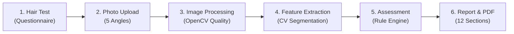

# Hair Health AI — Core Intelligence Engine & Assessment Platform

[](https://www.python.org/)
[](https://fastapi.tiangolo.com/)
[](https://opencv.org/)
[](https://nextjs.org/)
[](https://pytorch.org/)
[](LICENSE)

An independent, evidence-based hair and scalp health assessment engine. The platform collects user-reported health indicators, processes clinical scalp photographs across 5 standardized angles, measures visual contrast patterns using computer vision, and synthesizes structured, explainable health reports with automated PDF generation.

Designed to operate **completely Docker-free** and **without reliance on paid external AI APIs**.

---

## 🔬 Core Pipeline Architecture



1. **Hair Test (Questionnaire Engine)**: Collects structured user-reported hair, scalp, and lifestyle information.
2. **Photo Upload (Photo Collection Engine)**: Accepts standardized photos across 5 required angles (`front_hairline`, `top_scalp`, `crown`, `left_temple`, `right_temple`). Strips EXIF metadata, verifies resolution ($\ge 512 \times 512$), formats (JPG/PNG), computes SHA-256 hashes, and preserves privacy with unexposed disk storage.
3. **Image Processing (Image Quality Engine)**: Real-time OpenCV analysis computing Laplacian blur variance ($\sigma^2_{\text{Laplacian}}$), mean grayscale brightness, and contrast. Automatically flags blur, overexposure, and dark photos with granular warnings.
4. **Feature Extraction (Computer Vision Engine)**: Normalizes illumination (CLAHE in Lab color space), isolates central scalp Regions-of-Interest (ROI), segments hair fibers from visible scalp pixels using adaptive thresholding, computes lighting uniformity, and runs cross-regional contrast comparisons (e.g., vertex vs. mid-top scalp).
5. **Assessment (Assessment Engine)**: Strictly categorizes evidence into **User-Reported**, **Image-Observed**, and **Uncertain**. Avoids making unsupported claims or clinical alopecia diagnoses.
6. **Report (Report Generation Engine)**: Synthesizes a comprehensive 12-section structured JSON report and automatically compiles a standalone PDF document (`report_<id>.pdf`) complete with educational disclaimers.

---

## 📁 Repository Structure

```
hair-ai/
├── backend/
│   ├── alembic/              # Database schema migrations
│   ├── app/
│   │   ├── api/
│   │   │   ├── v1/
│   │   │   │   ├── auth.py         # Registration (Argon2id) & JWT login
│   │   │   │   ├── assessments.py  # Hair test submission & schema
│   │   │   │   ├── photos.py       # 5-angle upload & quality validation
│   │   │   │   ├── analysis.py     # Feature extraction trigger & query
│   │   │   │   ├── reports.py      # 12-section report & PDF download
│   │   │   │   └── users.py        # GDPR data export & right-to-be-forgotten
│   │   │   └── deps.py             # Auth dependencies & DB session
│   │   ├── core/
│   │   │   ├── config.py           # Pydantic settings & quality thresholds
│   │   │   ├── database.py         # MySQL connection (with portable dev fallback)
│   │   │   └── security.py         # Argon2id password hashing & JWT
│   │   ├── engine/
│   │   │   ├── questionnaire.py    # Module A: Questionnaire Engine
│   │   │   ├── image_quality.py    # Module C: OpenCV Image Quality Engine
│   │   │   ├── feature_extraction.py # Module D: Computer Vision Feature Engine
│   │   │   ├── ml_inference.py     # Module E: Model loader & fallback manager
│   │   │   ├── assessment.py       # Module F: Rule-based Assessment Engine
│   │   │   └── report.py           # Module G: Report synthesis & PDF compiler
│   │   ├── models/                 # SQLAlchemy ORM models (8 PRD tables)
│   │   ├── schemas/                # Pydantic request & response schemas
│   │   └── main.py                 # FastAPI application entrypoint
│   ├── ml/
│   │   ├── models/                 # Model checkpoints directory
│   │   └── src/
│   │       └── model.py            # PyTorch U-Net architecture definition
│   ├── storage/
│   │   ├── photos/                 # Private photo storage (no public URL access)
│   │   └── reports/                # Generated PDF reports
│   ├── tests/
│   │   └── test_core_engine.py     # Comprehensive automated test suite
│   ├── requirements.txt
│   ├── alembic.ini
│   └── .env.example
├── frontend/
│   ├── src/app/
│   │   ├── layout.tsx
│   │   ├── page.tsx                # Interactive 4-step dashboard & photo upload UI
│   │   └── globals.css             # Modern dark slate & teal UI styling
│   ├── package.json
│   ├── tsconfig.json
│   └── next.config.js
├── run_backend.bat                 # 1-Click launcher for Backend
├── run_frontend.bat                # 1-Click launcher for Frontend
├── .gitignore
└── README.md
```

---

## ⚡ Quick Start (Windows)

### 1-Click Launch
1. Double-click **`run_backend.bat`** (Starts FastAPI at `http://127.0.0.1:8000`)
2. Double-click **`run_frontend.bat`** (Starts Next.js at `http://localhost:3000`)
3. Open **`http://localhost:3000`** in your browser.

---

### Manual Setup (Cross-Platform)

#### 1. Backend Setup
```bash
# Clone the repository
git clone https://github.com/gauravyadabv/hair-ai.git
cd hair-ai

# Create and activate Python virtual environment
python -m venv backend/venv
# Windows:
.\backend\venv\Scripts\activate
# Linux/macOS:
source backend/venv/bin/activate

# Install dependencies
pip install -r backend/requirements.txt

# Run backend API
python -m uvicorn app.main:app --app-dir backend --host 127.0.0.1 --port 8000 --reload
```

#### 2. Frontend Setup
In a new terminal:
```bash
cd hair-ai/frontend
npm install
npm run dev
```

Visit:
- **Web App**: [http://localhost:3000](http://localhost:3000)
- **Interactive Swagger Docs**: [http://127.0.0.1:8000/docs](http://127.0.0.1:8000/docs)
- **ReDoc**: [http://127.0.0.1:8000/redoc](http://127.0.0.1:8000/redoc)

---

## 🧪 Testing

The repository includes a comprehensive automated test suite testing every stage of the pipeline:

```powershell
$env:PYTHONPATH="backend"
.\backend\venv\Scripts\pytest.exe backend\tests\test_core_engine.py -v
```

**Test Coverage:**
- `test_questionnaire_specification` — Schema and field validation
- `test_questionnaire_validation_and_categorization` — Categorization into personal, hair, scalp, lifestyle
- `test_image_quality_sharp_image` — Laplacian variance blur score computation
- `test_image_quality_low_resolution` — Resolution threshold enforcement ($< 512 \times 512$ rejection)
- `test_feature_extraction` — ROI bounding, CLAHE illumination normalization, and pixel segmentation
- `test_assessment_and_report_generation` — 3-way evidence classification and 12-section report generation
- `test_full_pipeline_e2e` — Full end-to-end integration test from questionnaire to PDF export

---

## 🛡️ Medical Safety & Ethical AI Principles

1. **Educational & Informational Only**: The system does **not** make clinical diagnoses (e.g., diagnosing androgenetic alopecia, alopecia areata, telogen effluvium, or nutritional deficiencies).
2. **Follicular Density vs. Pixel Contrast**: Pixel segmentation ratios reflect visible contrast under given lighting, not clinical follicle counts ($\text{FU/cm}^2$). True follicular density requires dermoscopy / trichoscopy with calibrated magnification.
3. **Three-Way Evidence Classification**: Assessments strictly isolate:
   - **User-Reported**: Information provided directly by the user.
   - **Image-Observed**: Contrast and coverage patterns extracted from photographs.
   - **Uncertain**: Clinical factors that cannot reliably be established from consumer photographs.
4. **Data Privacy**: Photos are stored in private local filesystems with SHA-256 hashes and are never exposed via public URLs or sent to third-party APIs.

---

## 👤 Author & Contact

Developed by **Gaurav Yadav**  
- **Email**: [garv9@proton.me](mailto:garv9@proton.me)  
- **GitHub**: [@gauravyadabv](https://github.com/gauravyadabv)  
- **Repository**: [https://github.com/gauravyadabv/hair-ai.git](https://github.com/gauravyadabv/hair-ai.git)

---

## 📄 License

This project is licensed under the [MIT License](LICENSE).
